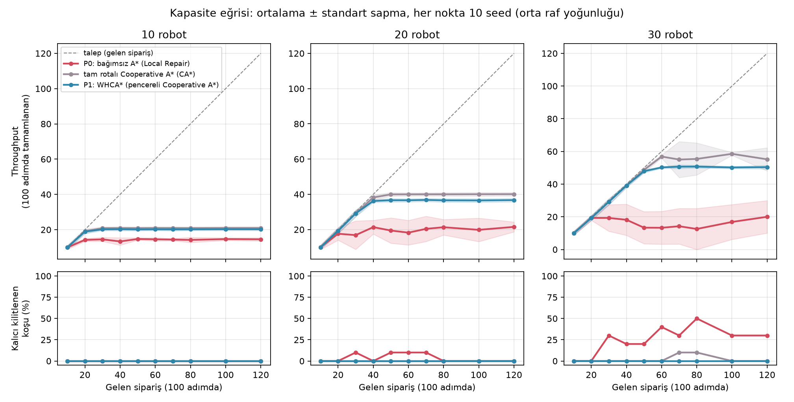
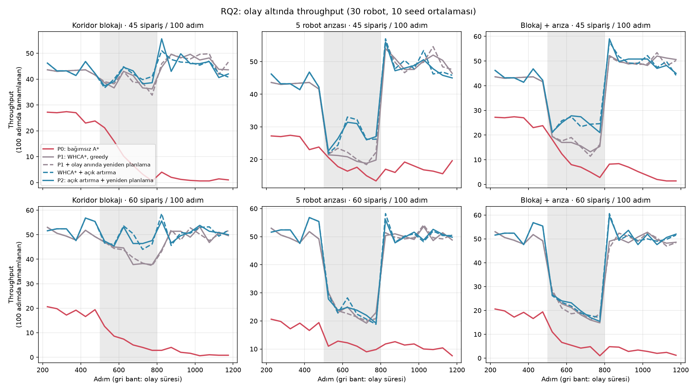
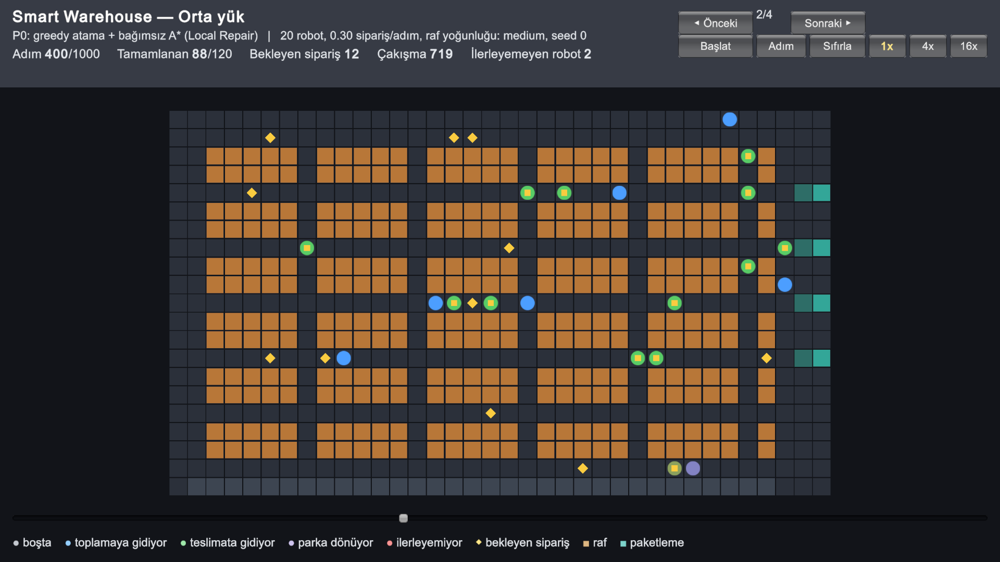

# Multi-Agent Smart Warehouse Simulator

BLM5026 Bilgisayar Oyunlarında Yapay Zeka dersi dönem projesi.

Bir depoda çok sayıda robot raflardan ürün alıp paketleme masalarına taşıyor. Robot sayısı arttıkça
robotlar dar koridorlarda karşılaşıyor, birbirini bekliyor ve bazen hiçbiri ilerleyemiyor. Bu projede
robotların birbirini kilitlemeden çalışabilmesi için farklı yöntemler denenecek.

Simülasyon için Python, görselleştirme için Unity kullanılıyor.

## Kurulum

Kurulum için: [uv](https://docs.astral.sh/uv/)

```bash
uv sync         # bağımlılıkları kurar
uv run pytest   # testleri çalıştırır
```

## Demo

```bash
uv run python demo.py   # küçük bir haritada A* ile bulunan yolu ekrana çizer
```

## Kullanılan algoritmalar

### A*

Tek bir robot için en kısa yolu bulur. Diğer robotları hesaba katmaz. Robot önünde başka bir
robot olduğu için ilerleyemezse yolunu yeniden planlar (Local Repair A*).

### WHCA*

Robotlar sırayla planlanır. Her robot hangi adımda hangi hücrede olacağını ortak bir tabloya
(rezervasyon tablosu) yazar. Sonraki robot yolunu bulurken tablodaki dolu hücrelerden kaçınır. A*'dan
farkı, robotların birbirinin nereden geçeceğini bilerek yol bulmasıdır. Yollar sadece önümüzdeki 16 adım
için ayrılır ve 8 adımda bir yeniden planlanır.

### Açık artırma

Her sipariş için robotlar teklif verir. Teklif, robotun elindeki işi bitirmesine kalan
süre ile işi bitirdiği yerden rafa olan mesafenin toplamıdır. En düşük teklifi veren robot siparişi alır.
Sonra kalan siparişler için açık artırma tekrarlanır.

## Yöntemler

1. Bağımsız A* yönteminde sipariş en yakın boştaki robota verilir. Her robot yolunu A* ile bulur.
2. WHCA* yöntemi 1. yöntemle aynıdır, ama yollar WHCA* ile planlanır.
3. WHCA* + açık artırma yönteminde siparişler açık artırmayla dağıtılır. Bir koridor kapanınca ya da robot
   arızalanınca, yolu etkilenen robotlar 8 adımı beklemeden hemen yeniden planlanır.

Kodda ve sonuç dosyalarında bu yöntemler `P0`, `P1` ve `P2` olarak geçer.

## Deneyler

Her simülasyon 1200 adım sürer. İlk 200 adım sonuçlara katılmaz. Aynı seed her yöntemde aynı
siparişleri üretir.

```bash
uv run python tools/run_capacity.py                        # kapasite deneyi
uv run --group analysis python tools/plot_capacity.py      # kapasite grafiği
uv run python tools/run_rq2.py                             # koridor kapanması ve robot arızası
uv run --group analysis python tools/plot_rq2.py           # olay deneyinin grafiği
uv run python tools/run_sensitivity.py                     # WHCA* pencere boyu denemesi
uv run python tools/run_experiments.py                     # ilk baseline deneyi
```

Kapasite deneyinde 10, 20 ve 30 robotla sipariş geliş hızı adım başına 0,1'den 1,2'ye kadar artırıldı.
Yöntemlerin ne kadar sipariş tamamlayabildiğine bakıldı. Karşılaştırma için yolun tamamını ayıran
Cooperative A* de denendi. Sonuçlar `results/capacity.csv` dosyasına yazılır.



Olay deneyinde 500. adımda ya bir koridor kapanır ya da 5 robot arızalanır. Olay 300 adım sürer.
Bu sırada ve sonrasında yöntemlerin ne kadar sipariş tamamladığına bakıldı.



## Unity

Unity 6 ve URP kullanılıyor, proje `unity/` klasöründe. Unity simülasyonu kendisi çalıştırmaz,
Python'un kaydettiği simülasyonları oynatır.

```bash
uv run python tools/export_replay.py   # simülasyon kayıtlarını unity/Assets/StreamingAssets/replay.json dosyasına yazar
```

Sonra `unity/` klasörü Unity Hub ile açılır ve `Assets/Scenes/Replay.unity` sahnesi çalıştırılır.



Tek robotun A* yolunu gösteren ilk sahne de duruyor. O sahne için `tools/export_scene.py` çalıştırılıp
`Assets/Scenes/Warehouse.unity` açılır.

## Plan

1. Izgara modeli ve tek robot için A*
2. Birden fazla robot ve basit görev atama (baseline)
3. Robotların birbirinin yolunu bildiği planlama (WHCA*)
4. Açık artırma ile görev atama
5. Unity ile görselleştirme
6. Deneyler ve makale
