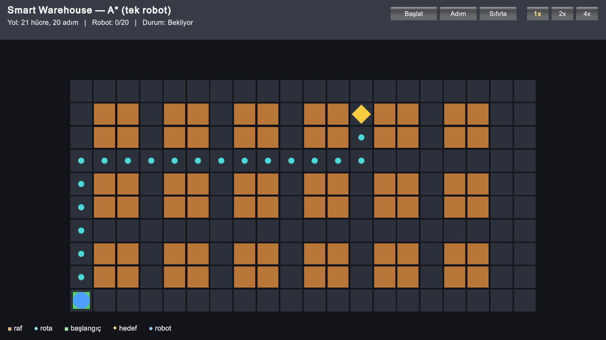

# Multi-Agent Smart Warehouse Simulator

BLM5026 Bilgisayar Oyunlarında Yapay Zeka dersi dönem projesi.

Bir depoda çok sayıda robot raflardan ürün alıp paketleme masalarına taşıyor. Robot sayısı arttıkça
robotlar dar koridorlarda karşılaşıyor, birbirini bekliyor ve bazen hiçbiri ilerleyemiyor. Bu projede
robotların birbirini kilitlemeden çalışabilmesi için farklı yöntemler denenecek.

Simülasyon için Python, görselleştirme için Unity kullanılıyor.

## Kurulum

Kurulum için: [uv](https://docs.astral.sh/uv/)

```bash
uv sync         # bağımlılıkları kurar
uv run pytest   # testleri çalıştırır
```

## Demo

```bash
uv run python demo.py   # küçük bir haritada A* ile bulunan yolu ekrana çizer
```

## Unity

Unity 6 ve URP kullanılıyor, proje `unity/` klasöründe. Şimdilik Unity, A* ile bulunan yolu tek bir
robotla gösteriyor. Yolu Python buluyor, Unity sadece çiziyor.

```bash
uv run python tools/export_scene.py   # haritayı ve yolu unity/Assets/StreamingAssets/scene.json dosyasına yazar
```

Sonra `unity/` klasörü Unity Hub ile açılır ve `Assets/Scenes/Warehouse.unity` sahnesi çalıştırılır.



## Plan

1. Izgara modeli ve tek robot için A*
2. Birden fazla robot ve basit görev atama (baseline)
3. Robotların birbirinin yolunu bildiği planlama (Cooperative A*)
4. Açık artırma ile görev atama
5. Unity ile görselleştirme
6. Deneyler ve makale
