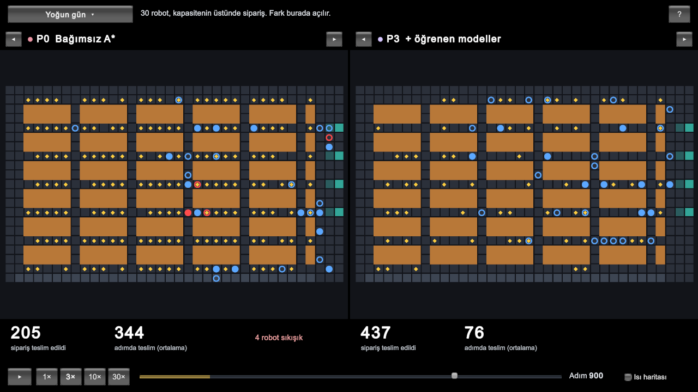
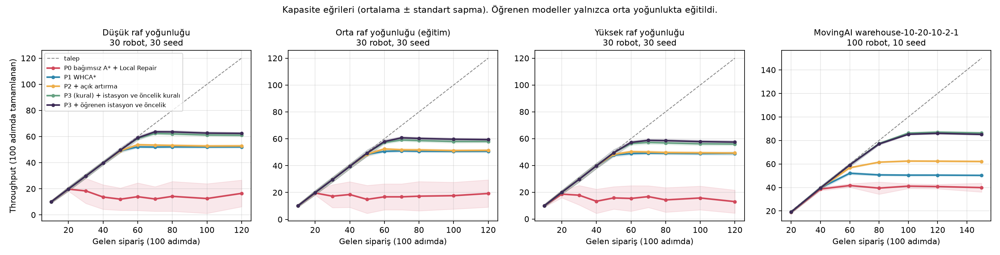

# Multi-Agent Smart Warehouse Simulator

BLM5026 Bilgisayar Oyunlarında Yapay Zeka dersi dönem projesi.

Bir depoda çok sayıda robot raflardan ürün alıp paketleme masalarına taşıyor. Robot sayısı arttıkça
robotlar dar koridorlarda karşılaşıyor, birbirini bekliyor ve bazen hiçbiri ilerleyemiyor. Siparişlerin
hangi robota verildiği ve ürünün hangi masaya götürüldüğü de bu sıkışıklığı etkiliyor. Bu projede bu
sorunlar için beş yöntem aynı sipariş akışında karşılaştırıldı. Ayrıca bir koridorun kapanması ve bazı
robotların arızalanması durumunda yöntemlerin nasıl davrandığı da incelendi.

Simülasyon için Python, görselleştirme ve arayüz için Unity kullanıldı.



## Kurulum

Kurulum için: [uv](https://docs.astral.sh/uv/)

```bash
uv sync         # bağımlılıkları kurar
uv run pytest   # testleri çalıştırır
```

## Kullanılan algoritmalar

### A*

Tek bir robot için en kısa yolu bulur. Diğer robotları hesaba katmaz. Robot önünde başka bir
robot olduğu için ilerleyemezse yolunu yeniden planlar (Local Repair A*).

### WHCA*

Robotlar sırayla planlanır. Her robot hangi adımda hangi hücrede olacağını ortak bir tabloya
(rezervasyon tablosu) yazar. Sonraki robot yolunu bulurken tablodaki dolu hücrelerden kaçınır. A*'dan
farkı, robotların birbirinin nereden geçeceğini bilerek yol bulmasıdır. Yollar sadece önümüzdeki 16 adım
için ayrılır ve 8 adımda bir yeniden planlanır.

### Açık artırma

Her sipariş için robotlar teklif verir. Teklif, robotun elindeki işi bitirmesine kalan
süre ile işi bitirdiği yerden rafa olan mesafenin toplamıdır. En düşük teklifi veren robot siparişi alır.
Sonra kalan siparişler için açık artırma tekrarlanır.

### Masa seçimi

Robot ürünü raftan aldığında hangi paketleme masasına gideceğine karar verilir. Her masa için dört sayıya
bakılır: robotun masaya olan mesafesi, o masaya robottan önce varacak robot sayısı, o masaya giden toplam
robot sayısı ve masanın 3 hücre yakınındaki robot sayısı.

Kural tabanlı sürümde her masa için mesafe ile robottan önce varacak robot sayısının 2 katı toplanır ve
toplamı en küçük olan masa seçilir. Yani önünde sıra olan masa, sıra kadar daha uzakmış gibi sayılır.
Buradaki 2 katsayısı 0 ile 16 arasındaki değerler denenerek seçildi.

Öğrenen sürümde bir regresyon modeli, bu dört sayıya bakarak her masa için ürünün kaç adımda teslim
edileceğini tahmin eder. Teslim süresi en kısa görünen masa seçilir. Model ridge regresyondur ve dört
sayının yanında bunların ikişerli çarpımlarını da kullanır.

Model simülasyon içinde eğitildi. Robot bir masa seçer, ürünü teslim edince ne kadar sürdüğü kaydedilir
ve model bu kayıtlarla yeniden eğitilir. Bu 40 simülasyon boyunca tekrarlandı ve yaklaşık 24.000 teslimat
kaydı toplandı. Model hep en iyi bildiği masayı seçerse diğer masaları hiç denemez ve onlar hakkında yanlış
tahminini düzeltemez. Bu yüzden eğitimde robot bazen rastgele bir masa seçti (ε-greedy). Rastgele seçim
oranı eğitimin başında %30 iken sonunda %5'e indi.

### Planlama sırası

WHCA*'ta robotların hangi sırayla planlanacağına karar verilir. Önce planlanan robot istediği yolu alır,
sonrakiler ona göre yol bulur. Kural tabanlı sürümde ürün taşıyan robotlar önce planlanır.

Öğrenen sürümde her robota bir puan verilir ve puanı büyük olan önce planlanır. Puan hesaplanırken
robotun şu özelliklerine bakılır: ürün taşıyıp taşımadığı, görevde olup olmadığı, hedefine olan mesafesi,
bu siparişte kaç adım beklediği, art arda kaç adımdır ilerleyemediği, 2 hücre yakınındaki robot sayısı ve
siparişin ne kadar zamandır beklediği. Her özellik kendi ağırlığıyla çarpılır ve sonuçlar toplanır.

Ağırlıklar çapraz entropi yöntemiyle (cross-entropy method, CEM) bulundu. Bu yöntemde önce rastgele
24 farklı ağırlık seti üretilir. Her set 6 simülasyonda denenir. En çok sipariş tamamlayan 6 set seçilir
ve yeni setler bu 6 setin ortalamasına yakın değerlerden üretilir. Bu işlem 12 tur tekrarlandı. Her turda
ağırlıklar iyi sonuç veren değerlere biraz daha yaklaşır.

## Yöntemler

1. Bağımsız A* yönteminde sipariş en yakın boştaki robota verilir. Her robot yolunu A* ile bulur. Ürün,
   siparişle birlikte rastgele belirlenen masaya götürülür.
2. WHCA* yöntemi 1. yöntemle aynıdır, ama yollar WHCA* ile planlanır.
3. WHCA* + açık artırma yönteminde siparişler açık artırmayla dağıtılır. Bir koridor kapanınca ya da robot
   arızalanınca, yolu etkilenen robotlar 8 adımı beklemeden hemen yeniden planlanır.
4. Kural tabanlı yöntemde 3. yönteme kural tabanlı masa seçimi ve planlama sırası eklenir.
5. Öğrenen yöntemde 3. yönteme öğrenen masa seçimi ve planlama sırası eklenir.

Kodda ve sonuç dosyalarında bu yöntemler sırasıyla `P0`, `P1`, `P2`, `P3-rule` ve `P3` olarak geçer.

## Deneyler

Her simülasyon 1200 adım sürer. İlk 200 adım sonuçlara katılmaz. Aynı seed her yöntemde aynı
siparişleri üretir. Modeller 1000-1099 seed'leriyle eğitildi, 2000-2009 seed'leriyle ayarlandı ve
0-29 seed'leriyle test edildi.

```bash
uv run python tools/run_final.py                           # ana deney
uv run --group analysis python tools/plot_final.py         # ana deneyin grafiği
uv run python tools/run_rq2.py                             # koridor kapanması ve robot arızası
uv run --group analysis python tools/plot_rq2.py           # olay deneyinin grafiği
uv run python tools/run_sensitivity.py                     # WHCA* pencere boyu denemesi
uv run python tools/train_station.py                       # masa seçimi modelini eğitir
uv run python tools/train_priority.py                      # planlama sırası ağırlıklarını bulur
```

Ana deneyde üç farklı raf yoğunluğunda üretilen depolar ve MovingAI'dan alınan bir depo haritası
kullanıldı. Robot sayısı 10 ile 100, sipariş geliş hızı adım başına 0,1 ile 1,5 arasında değiştirildi.
Sonuçlar `results/` klasörüne CSV olarak yazılır.



Bağımsız A* yoğun durumlarda simülasyonların bir kısmında kalıcı olarak kilitlendi. WHCA* kullanan
yöntemlerde kalıcı kilitlenme görülmedi. En yüksek işlem hacmine kural tabanlı ve öğrenen yöntemler
ulaştı. İkisi arasındaki fark küçük.

## Unity

```bash
uv run python tools/export_replay.py   # simülasyon kayıtlarını üretir
```

Sonra `unity/` klasörü Unity 6 ile açılır ve `Assets/Scenes/Replay.unity` sahnesi çalıştırılır.
Unity simülasyonu kendisi çalıştırmaz, Python'un kaydettiği simülasyonları oynatır.

Ekran ikiye bölünür ve aynı siparişler iki farklı yöntemle yan yana oynatılır. Üstten senaryo seçilir:
normal gün, yoğun gün, koridor kapanması, robot arızası ve büyük depo. Haritaların üstündeki oklarla
yöntem değiştirilir. Altta oynatma, hız ve zaman çubuğu var. Robota tıklanınca rotası görünür.
H tuşu, robotların en çok beklediği yerleri gösteren heatmap'i açar.

## Game AI Connection

Strateji oyunlarında birimler genelde Local Repair A* ile hareket ettirilir. Silver (2005), bu yöntemin
dar geçitli ve kalabalık haritalarda birimleri tıkadığını göstermiş ve çözüm olarak WHCA*'ı önermiştir.
Bu projede aynı yöntem depo robotlarına uygulandı. Oyundaki birimlerin yerini robotlar, oyun haritasının
yerini depo aldı.

## Assetler

Hazır asset kullanılmadı. Robot, ok gibi şekiller kodda çiziliyor (`SpriteUtil.cs`).
`unity/Assets/Welcome/` ve `unity/Assets/Settings/` Unity'nin 2D URP şablonundan geliyor.
MovingAI haritası [MovingAI MAPF benchmark](https://movingai.com/benchmarks/mapf.html) setinden alındı.
